# Zeron Pets

Animated pixel companions for [Zeron](https://github.com/zeronsh/zeron), perched above your message box.

## Install

Ask your Zeron agent:

> Install Zeron Pets from https://github.com/gumbarros/zeron-pets

Approve **Zeron Pets** when prompted. Repeat on each device. Only Zeron is required.

The plugin displays pets and uses chat IDs to remember your companion. It does not read your messages.

If you have the old **zeron-pets** plugin, disable it to avoid duplicates. Choose your pet and position again after installing this version.

## Use

Open **Settings → Plugins → Zeron Pets**:

- **Pet:** choose a character or **Random** to keep a random companion for each chat. New chats start with a random pet and keep it when opened again.
- **Pet position:** choose **Right**, **Left**, or **Random**.

Pets animate automatically and respect your system's **Reduce Motion** setting.

## Characters

Scroll horizontally to see all characters.

| Anti Sergio | Bergamini Cow | Creeper | Darth Revan | Ellie | Ezio | Gordon Freeman | Grand Admiral Thrawn | Hollow Knight | Jak and Daxter | Joel | Kratos | La Casa de Papel | Omniman | Ornstein & Smough | Otis the Cow | Siamese | Silksong | Squidward | The Witcher | Whiplash | Zombie |
| :---: | :---: | :---: | :---: | :---: | :---: | :---: | :---: | :---: | :---: | :---: | :---: | :---: | :---: | :---: | :---: | :---: | :---: | :---: | :---: | :---: | :---: |
| 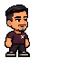 | 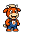 | 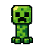 | 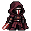 | 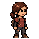 | 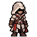 |  |  |  | 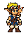 | 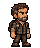 | 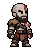 | 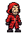 | 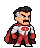 | 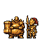 | 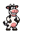 | 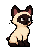 |  |  |  |  |  |

[MIT License](LICENSE).
