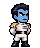
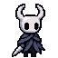
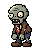
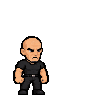

# Zeron Pets

Pixel pets for [Zeron](https://github.com/zeronsh/zeron).

## Pets

Choose a character in **Settings → Plugins → Zeron Pets → Pet**. **Random** is the default: each chat ID selects a stable pet, including after reopening the chat or restarting Zeron. Different chats can share a pet, changing the character roster can remap Random choices. Choose a specific character for existing chats. The new-chat window always shows a random pet; starting the chat keeps that pet, including after reopening or restarting Zeron. Changing the Pet setting applies your new choice. The plugin reads chat IDs to distinguish new chats from existing ones. Under **Pet position**, choose **Message box · Right** (the default), **Message box · Left**, or **Message box · Random**. Pets blink and make frequent gestures. Their position adjusts to stay inside the bar when it resizes. Respects system Reduce Motion and does not intercept mouse input.

| Character | Preview |
| --- | --- |
| Anti Sergio |  |
| Creeper |  |
| Darth Revan |  |
| Gordon Freeman |  |
| Grand Admiral Thrawn |  |
| Jak and Daxter |  |
| Hollow Knight |  |
| Silksong |  |
| Zombie |  |
| Ornstein & Smough |  |
| Omniman |  |
| Siamese |  |
| Squidward |  |
| The Witcher |  |
| Whiplash |  |


### Install

Install a signed `.zeron-plugin` file through **Settings → Plugins → Install…**,
or ask your Zeron agent to install its download link or GitHub release link.
The recipient only needs Zeron: no Git, Python, Pillow, Lua installation,
external signing tools or manual file copying. Zeron runs the bundled Luau code
and loads the included PNG frames inside its plugin sandbox.

Then allow **Zeron Pets** in Zeron's plugin review. It requests `ui.add` to draw
pets and `sessions.read` to keep each chat's pet stable; it does not read messages.
Approval is required on each device.

This release uses the native Zeron signing identity and the new plugin ID
`zeron-pixel-pets`. The legacy `zeron-pets` ID was signed with a standalone key
that Zeron cannot transfer. Install this package as a new plugin and disable the
old one to avoid duplicate pets. Settings and per-chat pet choices do not migrate;
choose your pet and position again in the new plugin's settings.

### Develop

The tools below are for editing artwork and checking source code only; they
are not installation or runtime requirements.

The plugin source lives at the repository root. Each pet has its own source sheet at `art-src/<pet>/atlas.png` and runtime frames at `art/<pet>/<frame>.png`. Edit its sheet to change the artwork; `art-src/sprite.py` imports it into runtime sprites. Regenerate the 105 PNG frames with Python and Pillow:

```sh
python art-src/sprite.py
```

An optional argument writes a labeled preview of every pet and frame:

```sh
python art-src/sprite.py /tmp/pets-preview.png
```

Run chat-selection checks with `lua scripts/test_pet_selection.lua`.

### Sign and distribute

Use Zeron's native signing, with Zeron running. Sign in to Zeron and claim a
username to identify releases as yours. A locally valid signature alone does
not establish a publicly verified author.

1. Run the relevant checks. Find the installed folder with `zeron plugin list`.
2. Sync this repository's non-hidden contents to that folder, removing obsolete
   files. Exclude `.git`, caches and private keys.
3. Sign and verify the installed plugin:

   ```sh
   zeron plugin sign zeron-pixel-pets
   zeron plugin verify <installed-plugin-folder>
   ```

   If signing needs consent, decide in Zeron's window. The legacy key transition
   must be approved there; do not bypass it with a custom signing script.
4. Copy the installed folder's signed `zeron-plugin.json` back to the repository
   as the final file change, then run `zeron plugin verify .`.
5. Export the installed plugin:

   ```sh
   zeron plugin export zeron-pixel-pets
   ```

   Keep the returned `.zeron-plugin` file outside the repository and attach it
   to a GitHub release, or send it directly. Verify the repository again after
   export; if its signature changed, copy the exported plugin's manifest back
   from the installed folder and verify again.

Commit the signed manifest with the changes. Any later edit requires signing
again. Increment the version for each update and preserve the native signing
identity. Zeron hashes every non-hidden file regardless of `.gitignore`; remove
`__pycache__` and `.pyc` files before signing. Never copy private keys into the
repository or to recipients.

See Zeron's [sharing and installation guide](https://github.com/zeronsh/zeron/blob/main/apps/zgx/docs/plugins.md#sharing-and-installing).

Adapted from Zeron's [Composer Cat development plugin](https://github.com/zeronsh/zeron/tree/main/apps/zgx/plugins-dev/composer-cat). Original MIT license retained in [LICENSE](LICENSE).

### Translations

English and Portuguese catalogs live in `locales/en.json` and
`locales/pt.json`. Zeron resolves Portuguese variants such as `pt-BR`
through `pt`, with English as the fallback. Use `zeron.t` or `zeron.s`
for plugin-rendered text.

Zeron currently displays manifest names, descriptions, and setting options
as literal strings. The catalogs include their translations, but showing
those translations in the host settings requires localization support in Zeron.

Creeper occasionally charges, explodes into pixel smoke and returns to idle (roughly every 18–30 seconds). Reduce Motion disables the animation.
