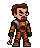
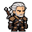

# Zeron Pets

Pixel pets for [Zeron](https://github.com/zeronsh/zeron).

## Pets

Choose a character in **Settings → Plugins → Zeron Pets → Pet**. **Random** is the default: each chat ID selects a stable pet, including after reopening the chat or restarting Zeron. Different chats can share a pet, changing the character roster can remap Random choices. Choose a specific character to use it in every chat. Pets sit at a random fixed position along the message box, blink, and make frequent gestures. Their position adjusts to stay inside the bar when it resizes. Respects system Reduce Motion and does not intercept mouse input.

| Character | Preview |
| --- | --- |
| Anti Sergio |  |
| Darth Revan |  |
| Gordon Freeman |  |
| Hollow Knight |  |
| Omniman |  |
| Siamese |  |
| Squidward |  |
| The Witcher |  |
| Whiplash |  |

### Install

Ask your Zeron agent:

> Install the plugin at https://github.com/gumbarros/zeron-pets

Then allow **Zeron Pets** in Zeron's plugin review. It only requests `ui.add`; no network, commands, or message access.

### Develop

The plugin source lives at the repository root. Each pet has its own source sheet at `art-src/<pet>/atlas.png` and runtime frames at `art/<pet>/<frame>.png`. Edit its sheet to change the artwork; `art-src/sprite.py` imports it into runtime sprites. Regenerate the 71 PNG frames with Python and Pillow:

```sh
python art-src/sprite.py
```

An optional argument writes a labeled preview of every pet and frame:

```sh
python art-src/sprite.py /tmp/pets-preview.png
```

Run chat-selection checks with `lua scripts/test_pet_selection.lua`.

Editing files invalidates the plugin signature. Sign offline using Python 3.10+
and OpenSSL; no running Zeron or Python packages are required:

```sh
PYTHONDONTWRITEBYTECODE=1 python scripts/test_sign.py
python scripts/sign.py
python scripts/sign.py --verify
```

The private Ed25519 PEM key defaults to
`~/.config/zeron-pets/signing-key.pem`; pass `--key /path/to/key.pem` to override.
Keep and back up this key outside the repository. For a brand-new signing identity
only, create it once (never overwrite an existing key):

```sh
mkdir -p ~/.config/zeron-pets
(umask 077; set -C; openssl genpkey -algorithm ED25519 > ~/.config/zeron-pets/signing-key.pem)
```

Commit the updated `zeron-plugin.json` with every change, and sign again if any
file changes afterward. Zeron hashes non-hidden files regardless of `.gitignore`;
remove generated `__pycache__` folders and `.pyc` files before signing. A new key
changes the signer and may require reinstalling an existing plugin. An unregistered
key appears as an unknown author; users still allow the plugin in Zeron's review.

Adapted from Zeron's [Composer Cat development plugin](https://github.com/zeronsh/zeron/tree/main/apps/zgx/plugins-dev/composer-cat). Original MIT license retained in [LICENSE](LICENSE).

### Translations

English and Portuguese catalogs live in `locales/en.json` and
`locales/pt.json`. Zeron resolves Portuguese variants such as `pt-BR`
through `pt`, with English as the fallback. Use `zeron.t` or `zeron.s`
for plugin-rendered text.

Zeron currently displays manifest names, descriptions, and setting options
as literal strings. The catalogs include their translations, but showing
those translations in the host settings requires localization support in Zeron.
